# dreamcade

**Arcade games that run entirely inside a neural network, including a 3D dungeon crawler.**

[](https://github.com/aamodbhatt/dreamcade/actions/workflows/ci.yml)
[](LICENSE)


<p align="center">
  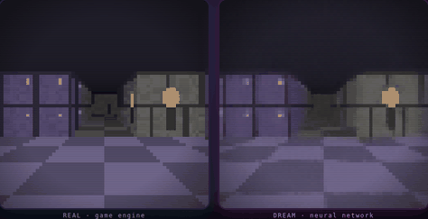
</p>

<p align="center"><em>Left: a real Wolfenstein-style raycaster. Right: an 18.5M-parameter diffusion model dreaming
the same walk, frame by frame, from nothing but the last four frames and the key presses.
There is no game engine on the right. Recorded from the browser player.</em></p>

<p align="center">
  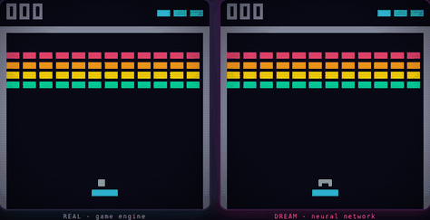
</p>

## Play it in two commands

You need [uv](https://docs.astral.sh/uv/) (it brings its own Python). The base install is just
NumPy; the models (fp16 ONNX) ship in the repo and run in your browser.

**macOS / Linux**

```bash
git clone https://github.com/aamodbhatt/dreamcade && cd dreamcade
uv run dreamcade play          # then open http://127.0.0.1:8095
```

**Windows (PowerShell)**

```powershell
git clone https://github.com/aamodbhatt/dreamcade; cd dreamcade
uv run dreamcade play          # then open http://127.0.0.1:8095
```

Controls: **W/S** or arrows to walk, **A/D** to turn, **Q/E** to strafe; Breakout uses
**left/right** and **Space**. Leave it alone for 20 seconds and it switches to an
arcade-style attract mode.

## Why

Video diffusion models are learning to be world simulators: GameNGen dreams DOOM, DIAMOND
dreams Atari and CS:GO. Those systems need TPU pods or days of GPU time, and their
interesting failure modes are hard to see without ground truth next to them.

dreamcade is the same idea at a size you can read in an afternoon and run in a browser tab,
with the real game running beside the dream so every frame of fidelity (and every
hallucination) is measurable.

## What it does

- **Two games, two kinds of world model.**
  - *Breakout* (64x64, 8-colour palette): a deterministic next-frame model that classifies
    every pixel into a palette colour in one forward pass. It is crisp and fast, and its
    mistakes are discrete, so they are easy to count.
  - *Dungeon* (64x64 RGB raycaster with textured rooms, coloured doors, torches and floating
    orbs): an action-conditioned EDM diffusion model in the style of DIAMOND/GameNGen. It
    sees 4 past frames and actions, uses context-noise augmentation and samples in 3 Euler steps.
- **Browser player** (vanilla ES modules plus onnxruntime-web, WebGPU with a WASM fallback):
  - **Dream / Real / Split / Diff** views and a live PSNR readout;
  - a diffusion-steps slider and a **Corrupt memory** button that scrambles what the network
    remembers, so you can watch it recover or hallucinate;
  - the FPS and backend shown on screen, and a CRT look over crisp nearest-neighbour pixels.
- **Exact ground truth.** Both engines are deterministic NumPy (the dungeon is vectorised over
  agents) with JavaScript ports that reproduce golden trajectories *bit-for-bit* (Breakout,
  601 frames) and *pixel-for-pixel* (dungeon, 301 frames).
- **Research harness.** Exploration policies with coverage statistics, rollout-fidelity and
  perceptual metrics over the horizon, sampling-time ablations, linear probes with a
  random-network control, and a failure gallery.

## How it works

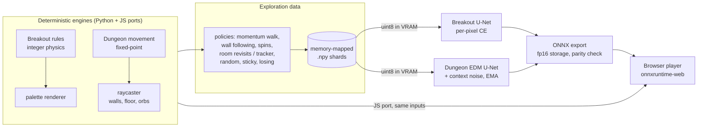

**The dream loop.** Each tick the player reads your key, steps the *real* engine, and asks
the network for the next frame given the last four *dreamed* frames and actions. For the
dungeon that means drawing a fresh Gaussian image and denoising it in 3 Euler steps with the
EDM-preconditioned U-Net; the result becomes part of the context for the next frame. Nothing
else carries state: the dungeon's geometry, textures and the room behind you exist only in
the network's weights and its four-frame memory.

**Why it does not fall apart immediately: temporal consistency.** Autoregressive video
models drift because errors compound: a slightly blurry frame becomes the input for the next
one, which is blurrier still. This is the same problem video inpainting faces when it fills
frame *t* from frames it filled earlier. Two choices here fight it:

1. *Context-noise augmentation.* During training the context frames are corrupted with
   Gaussian noise of a random level that the network is told about. The model learns to treat
   its context as "approximately right" and to pull its prediction back onto the manifold of
   clean frames, rather than copying artefacts forward.
2. *EDM preconditioning and few-step sampling.* The denoiser always predicts a clean frame,
   so even 3 steps give a sharp image rather than a noisy residual. Sharp frames are
   in-distribution context for the next step, and blurry ones are not.

**Why Breakout is not a diffusion model.** The engine resolves collisions by look-ahead
reflection, so the displacement between two frames *is* the ball's velocity and the next
frame is a deterministic function of two frames and an action. A per-pixel classifier is
the right tool: exact when right, and every error is countable.

**Making 18.5M parameters browser-sized.** A 2x2 pixel-unshuffle stem runs the whole U-Net at
32x32 (about 4x fewer FLOPs than a full-resolution stem). The weights are stored as fp16
inside the ONNX file and cast to fp32 in-graph, which halves the download (38 MB) and runs on
every backend, including WASM, which has no fp16 kernels. The file is split into 15 MB parts
that the player joins and checks against a SHA-256 hash.

## Results

All numbers are from real runs on a **single NVIDIA A40 (48 GB) shared with other jobs, with
about 8 vCPUs**. The whole project used at most **76 GPU-minutes** (job wall-clock, including time spent waiting for a shared GPU slot). These are short runs by
world-model standards: the dungeon model saw 1.44M training windows, about 5 passes over its data.

### Dungeon diffusion world model

| | |
| --- | --- |
| Data | 288k frames from 576 exploration episodes; all 196 free tiles visited (min 396 visits per tile) |
| Model | EDM U-Net, 18.5M params, 4-frame context, attention at 8x8 |
| Training | 11,234 steps x 128 = 1.44M samples in 46 min (bf16, EMA 0.999) |
| One-step validation PSNR | 29.7 dB on held-out episodes (3 Euler steps) |
| ONNX parity (fp16-rounded weights) | max abs diff 6.6e-7 |

<p align="center">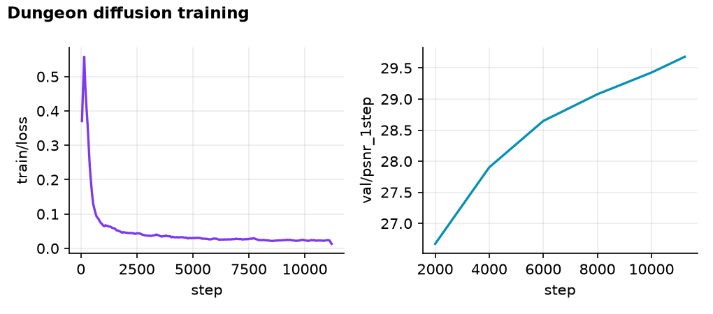</p>

**Fidelity over a 48-frame dream.** 32 random starts per script: real context, then the
model runs on its own outputs while the real engine gets the same actions (3 steps, context
noise 0.05).

| Script | PSNR t+1 | t+8 | t+16 | t+32 | t+48 | LPIPS t+1 | t+16 | t+48 |
| --- | --- | --- | --- | --- | --- | --- | --- | --- |
| walk (forward, turns) | 28.9 | 24.0 | 22.3 | 20.3 | 19.1 | 0.051 | 0.152 | 0.252 |
| strafe | 29.4 | 25.2 | 24.5 | 23.1 | 22.4 | 0.062 | 0.137 | 0.165 |
| turn around (180 deg, then walk) | 29.5 | 23.5 | 21.0 | 20.8 | 17.5 | 0.038 | 0.273 | 0.392 |
| spin in place | 29.5 | 23.7 | 20.7 | 19.8 | 17.9 | 0.052 | 0.292 | 0.391 |

<p align="center">
  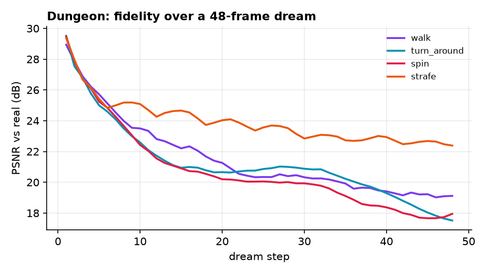
  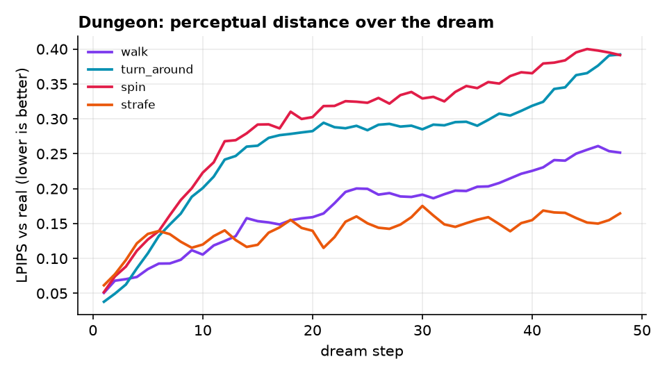
</p>

Strafing and walking keep most of the view on screen, so four frames of memory are enough.
Turning around is the hard case: the room that comes into view has to come from the weights,
because it is not in the context.

**Sampling-time ablations** (means over all four scripts and 48 steps):

| Euler steps | PSNR | LPIPS | PSNR, first 8 |
| --- | --- | --- | --- |
| 1 | **22.46** | 0.259 | 26.98 |
| 2 | **22.46** | 0.259 | **26.99** |
| 3 (default) | 21.87 | 0.217 | 26.09 |
| 4 | 21.36 | **0.215** | 25.81 |
| 8 | 20.30 | 0.225 | 24.89 |

This is the perception-distortion trade-off in miniature. One or two steps give a conditional
*mean*, a blurry average that scores well on PSNR. Three or four steps commit to sharp detail,
which LPIPS rewards but which is penalised whenever it is the wrong detail. Eight steps
commit to more detail and drift further. The player defaults to 3 steps.

| Context noise at sampling time | PSNR | LPIPS |
| --- | --- | --- |
| 0.00 | 21.94 | 0.213 |
| 0.05 (default) | 21.87 | 0.217 |
| 0.10 | 21.87 | 0.215 |
| 0.20 | 21.61 | 0.220 |

The model was trained with context noise up to 0.3, so it tolerates noisy memory well. Adding
noise at sampling time made no measurable difference on these 48-frame scripts. This is a
cheap sampling-time ablation only: there was no GPU budget for a second model trained
*without* context noise, so the training-time effect is not measured here (see Roadmap).

### Failure gallery: dream logic

Each image has four rows: a *median* start (real, then dream) and the *worst* start (real,
then dream), at the same moments of a 48-frame dream.

**Turn around.** In the median case the red hall is rebuilt correctly behind the player. In
the worst case the dream walks through the red orb and wakes up facing a grey stone corridor
that is not there. Once the context holds only the dream's own frames, the network has no way
to know it is wrong.

<p align="center">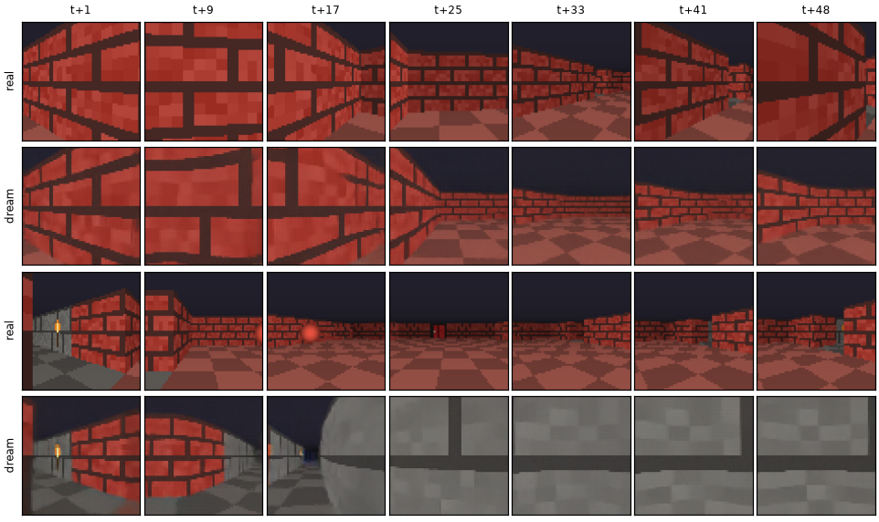</p>

**Walk.** The median case follows the blue vault's door for 48 frames. In the worst case the
mossy cave is right until a close-up wall fills the screen, and then it loses where the
door was.

<p align="center">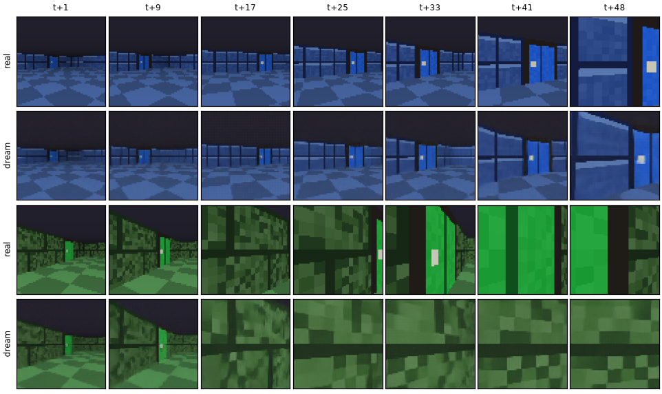</p>

**Spin.** A full turn in place is the hardest test of memory.

<p align="center">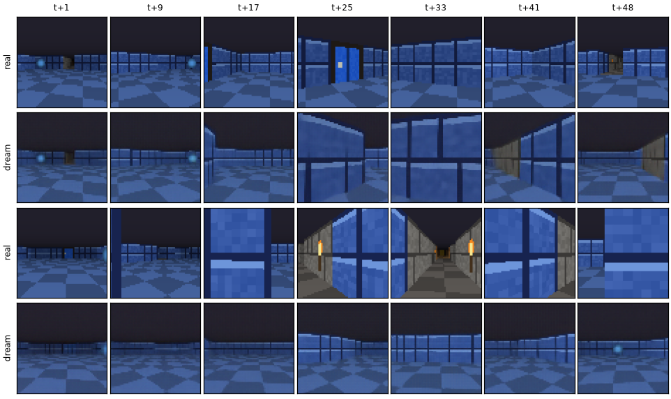</p>

### Breakout: a study of learned physics

Two 6-minute runs (4.8M params, 1.4k steps each) that differ only in the context: always
ground truth (*teacher forcing*), or with up to 4% of context pixels recoloured at random
(*context noise*). Each was evaluated on 256 held-out starts, rolled out for 120 steps on its own
predictions with the recorded actions.

| | exact frame @1 | @10 | @30 | median first divergence | ball error @30 | @120 |
| --- | --- | --- | --- | --- | --- | --- |
| teacher forcing | 0.836 | 0.520 | 0.039 | 9 steps | 11.0 px | 21.0 px |
| context noise | **0.898** | **0.609** | **0.098** | **13 steps** | **7.7 px** | **15.7 px** |

<p align="center">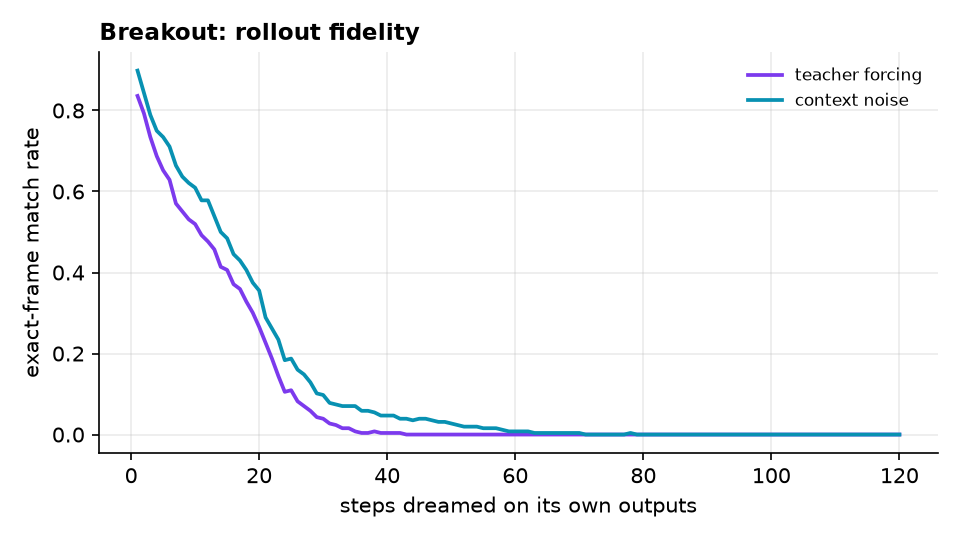</p>

Context noise helps at every horizon, which is the discrete counterpart of the dungeon's
Gaussian context noise. Both models are undertrained (6 minutes each), so exact-frame
agreement decays within tens of steps. They never drop the ball (it is missing in under 1%
of frames), but its position slowly drifts away from the real one.

**Linear probes.** Ridge regression from the 8x8x192 bottleneck to the ball's state
(held-out R^2, 3,000 in-play frames), against the same probe on a randomly initialised
network of identical shape:

| | ball x | ball y | velocity x | velocity y |
| --- | --- | --- | --- | --- |
| trained (teacher forcing) | 0.961 | 0.952 | 0.615 | 0.844 |
| trained (context noise) | 0.973 | 0.963 | 0.724 | 0.792 |
| random-init control | 0.841 | 0.733 | 0.340 | 0.229 |

Position is largely recoverable even from random features, since convolutions preserve
where things are. Velocity is not: training lifts it from about 0.3 to 0.6-0.8 R^2. Velocity
is never drawn on screen, so the network has learned to compute it as the difference
between frames.

<p align="center">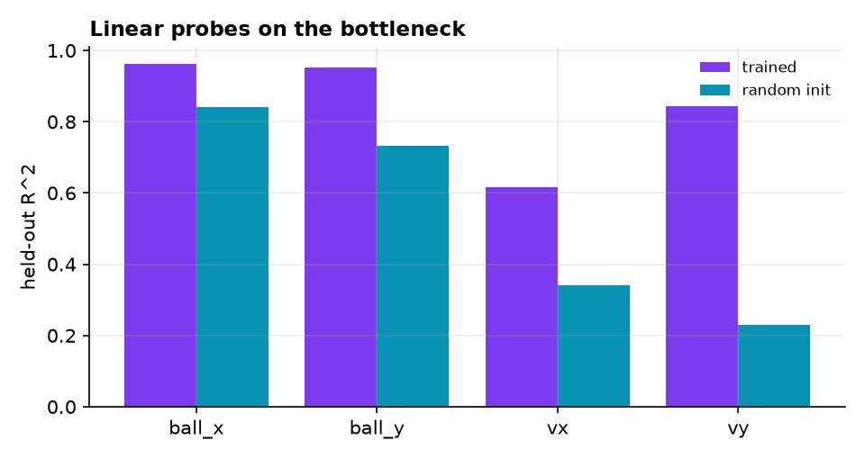</p>

### In the browser

Both GIFs above were recorded with Playwright and headless Chromium 156 driving the real
player on the pod, in frame-step mode: the recorder advances one tick, waits for the dream
frame and takes a screenshot. The GIFs therefore play at the game's tick rate (15 Hz for the
dungeon, 30 Hz for Breakout), whatever the inference speed. Real-time speed was then measured
free-running, over 40 ticks, in the same headless Chromium on the pod's CPU (a quota of about
8 cores):

| Game | Backend | Model time per frame | Dream FPS |
| --- | --- | --- | --- |
| Dungeon (3 Euler steps = 3 network calls) | WASM, cross-origin isolated (threads) | 259 ms | **3.7** |
| Breakout (1 network call) | WASM, cross-origin isolated (threads) | 60 ms | **14.9** |
| Either game | WebGPU | not measured | not measured |

**Every browser number in this README is a WASM (CPU) number from headless Chromium.** The
pod's headless Chromium exposes no hardware WebGPU adapter (forcing it on gives a SwiftShader
software adapter, which is slower than WASM), so no GPU was used for browser inference. In a
desktop browser with WebGPU, the player picks the GPU backend automatically and shows it on
screen. One dungeon network call is about 5.5 GFLOPs, so WebGPU on a discrete GPU should be much
faster than the CPU path, but **WebGPU speed has not been measured**. On WASM the dungeon is
playable as a slow dream; drop the steps slider to 1 for roughly 3x the frame rate (with
blurrier frames, see the ablation above). Raw measurements:
[`browser_dungeon.json`](docs/results/browser_dungeon.json),
[`browser_breakout.json`](docs/results/browser_breakout.json).

## Design decisions and trade-offs

- **Pixel-space EDM over latent diffusion.** At 64x64 an autoencoder saves little compute
  and adds a second model whose artefacts compound. See [docs/DESIGN.md](docs/DESIGN.md).
- **A fixed-point, integer-trig engine.** Positions are in 1/256 tiles and the heading is one
  of 64 angles with an integer cos/sin table, so Python and JS agree exactly and the
  golden-trajectory tests can demand identical pixels rather than "close enough".
- **The dataset lives in VRAM as uint8.** 3.5 GB of frames on the GPU and one gather per
  batch, so 8 shared CPU cores never starve the A40.
- **Breakout as a classifier, the dungeon as diffusion.** Use stochastic generation only
  where the future is uncertain to the model (unseen geometry); use exact prediction where
  it is not.
- **fp16 storage, fp32 compute.** Half the download, and every backend can run it.

## Testing

```bash
uv sync --extra ml --group dev
uv run pytest                 # 34 tests, ~30 s on CPU
node tests/js/parity.mjs      # JS ports vs Python golden trajectories
uv run ruff check . && uv run ruff format --check . && uv run mypy   # strict
```

The suite covers:

- engine determinism and invariants, including a Hypothesis property that agents never enter walls;
- the batched raycaster against single renders, and that the browser world file is current;
- Python and JavaScript parity on golden trajectories;
- shard shapes and generation determinism, model output shapes and the EDM preconditioning identities;
- the Euler and Heun **samplers recovering a 2-D Gaussian mixture** with an exact denoiser;
- CPU training smoke tests with checkpoint **resume**;
- **ONNX export parity** on tiny models.

CI runs all of it on Ubuntu with CPU-only PyTorch.

## Reproduce

```bash
uv sync --extra ml --group dev
uv run dreamcade gen --config configs/gen_dungeon.toml --out data/dungeon
uv run dreamcade gen --config configs/gen_breakout.toml --out data/breakout
uv run dreamcade train dungeon --config configs/dungeon_pod.toml       # ~46 min on an A40
uv run dreamcade train breakout --config configs/breakout_cn.toml      # ~6 min
uv run dreamcade eval dungeon --run runs/dungeon --data data/dungeon --out docs/results
uv run dreamcade eval breakout --runs runs/breakout_tf runs/breakout_cn --data data/breakout --out docs/results
uv run dreamcade export dungeon --run runs/dungeon --out web/models
uv run dreamcade export breakout --run runs/breakout_cn --out web/models
```

`configs/*_laptop.toml` are CPU-sized versions of the training configs. Every run writes JSONL
metrics (`{"step": ..., "train/loss": ..., "_time": ...}`) and resumes from its last checkpoint.

## Project layout

```
src/dreamcade/
  game/        Breakout rules + palette renderer
  dungeon/     world data, vectorised movement, vectorised raycaster
  data/        exploration policies, shard I/O, generation, coverage
  models/      U-Net blocks, dungeon EDM U-Net + sampler, Breakout classifier
  train/       training loops, GPU-resident windows, EMA, checkpoints
  evaluate/    rollouts, ablations, probes, figures
  export.py    ONNX export + parity + split manifest
  serve.py     `dreamcade play` (COOP/COEP static server)
web/           the player: index.html, css/, js/ (engine ports, dream runtimes), models/, assets/
tests/         pytest suite, golden trajectories, Node parity script
scripts/       Playwright capture (README GIFs + browser FPS)
configs/       typed TOML configs (pod and laptop sizes)
docs/          DESIGN.md, results/ (JSON, plots, galleries), assets/ (GIFs)
```

## Limitations

- **Short training.** 46 GPU-minutes for the dungeon and 6 minutes per Breakout model.
  Long-horizon dreams drift, especially after turning around (see the gallery).
- **Four frames of memory.** The dungeon model has no long-term memory. Rooms you leave are
  rebuilt from the weights, and sometimes they are rebuilt wrong.
- **Ablations are sampling-time only** for the dungeon (Euler steps and context-noise level).
  Context length and training without context noise were not run.
- **Browser speed depends on WebGPU, which was not measured.** On CPU-only WASM in headless
  Chromium the dungeon dream runs at about 3.7 FPS and Breakout at 14.9 FPS. See the browser
  numbers above.

## Roadmap

- Train a no-context-noise dungeon model and models with 1, 2 and 8 context frames, at equal compute.
- Distil the 3-step sampler to 1 step (consistency or progressive distillation) for WASM speed.
- Scheduled-sampling (unrolled) training for Breakout, the third arm of the rollout study.
- Longer dungeon training and a 96x72 variant.

## License

[MIT](LICENSE) © 2026 Aamod Bhatt
